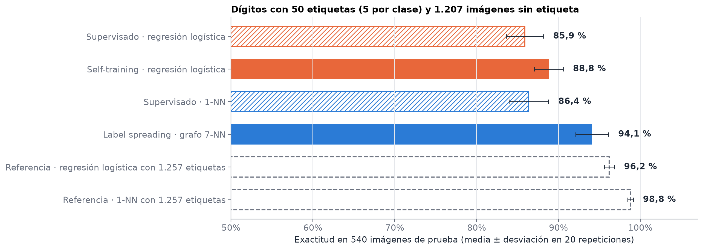
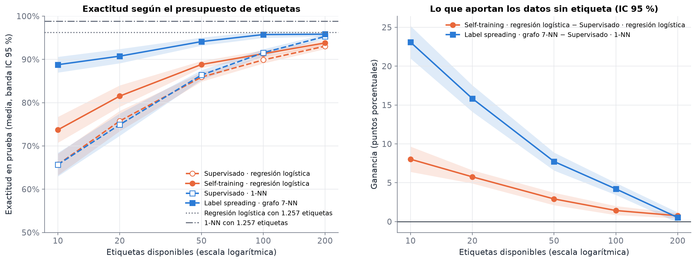

# Aprendizaje semisupervisado: ¿cuándo ayudan los datos sin etiqueta?

Ejemplo computacional en Python sobre aprendizaje semisupervisado, desarrollado para la exposición del curso **Aprendizaje Automático** (Universidad EAFIT, 2026-2).

**Autores:** Juan Alberto, Alejandro García, Daniel y Juan Esteban.

## Descripción

En muchos problemas reales es fácil reunir datos, pero etiquetarlos es costoso: requiere tiempo, dinero y, a menudo, un experto. El aprendizaje semisupervisado busca aprovechar a la vez unas pocas observaciones etiquetadas y una gran cantidad de observaciones sin etiquetar.

En este repositorio evaluamos experimentalmente esa idea con dos métodos clásicos, **self-training** y **label spreading**, implementados en scikit-learn. El trabajo completo está en el notebook [`aprendizaje_semisupervisado.ipynb`](aprendizaje_semisupervisado.ipynb), que reúne la explicación, el código, los resultados y su interpretación.

## Objetivo

Responder a la siguiente pregunta:

> Con un presupuesto fijo de etiquetas, ¿cuánto mejora un clasificador al añadir datos sin etiqueta, de qué depende esa mejora y cuándo desaparece o se vuelve negativa?

Para ello analizamos tres aspectos:

1. La ganancia que aportan los datos sin etiqueta según el número de etiquetas disponibles.
2. El papel de los supuestos del aprendizaje semisupervisado, en particular el supuesto de clúster.
3. Los riesgos del self-training: el umbral de confianza y el sesgo de confirmación.

## Datos

| Conjunto | Fuente | Uso en el notebook |
|---|---|---|
| **Optical Recognition of Handwritten Digits**: 1.797 imágenes de 8 × 8 píxeles con valores entre 0 y 16, 10 clases | UCI Machine Learning Repository (Alpaydin y Kaynak, 1998), [doi:10.24432/C50P49](https://doi.org/10.24432/C50P49). Se carga con `sklearn.datasets.load_digits()`, sin descargas | Experimento principal |
| **Dos lunas**: datos sintéticos en dos dimensiones | `sklearn.datasets.make_moons`, con semilla fija | Visualizar el funcionamiento de los métodos y controlar el supuesto de clúster |

Elegimos el conjunto de dígitos porque es una tarea real de visión por computador, en la que el etiquetado manual es el principal costo, y porque permite simular escenarios con pocas etiquetas conservando las etiquetas verdaderas para evaluar. Además, su tamaño permite repetir cada experimento 20 veces en pocos minutos y medir la variabilidad de los resultados.

## Metodología

- **Métodos.** Self-training sobre una regresión logística (umbral de confianza 0,8) y label spreading sobre un grafo de 7 vecinos más cercanos (α = 0,99).
- **Comparaciones dentro de la misma familia de modelos.** El self-training se compara con la regresión logística supervisada y label spreading con el clasificador de 1 vecino más cercano (1-NN). Así, la mejora puede atribuirse a los datos sin etiqueta y no a un cambio de modelo.
- **Protocolo.** Partición estratificada 70/30 (1.257 imágenes de entrenamiento y 540 de prueba), presupuestos de 10, 20, 50, 100 y 200 etiquetas balanceadas por clase y 20 repeticiones con particiones y etiquetas distintas. Las diferencias se reportan como diferencias pareadas con intervalos de confianza del 95 %.
- **Evaluación.** Los hiperparámetros se fijan de antemano y el conjunto de prueba solo se usa para medir el desempeño final.

El notebook está organizado en cinco partes:

1. **Intuición en dos dimensiones:** fronteras de decisión y propagación de etiquetas en las dos lunas.
2. **Cuándo falla:** efecto de debilitar el supuesto de clúster.
3. **Dígitos escritos a mano:** resultados con 50 etiquetas y curva de aprendizaje.
4. **Self-training en detalle:** umbral, calibración del modelo y sesgo de confirmación.
5. **Conclusiones, recomendaciones y limitaciones.**

## Principales resultados

| | |
|---|---|
|  |  |

- **Con 50 etiquetas** (5 por dígito), label spreading alcanza un 94,1 % de exactitud frente al 86,4 % de su contraparte supervisada, una mejora de 7,7 puntos porcentuales que se mantiene en las 20 repeticiones. El resultado queda a 2,1 puntos de una regresión logística entrenada con las 1.257 etiquetas.
- **La mejora depende de la estructura de los datos.** En las dos lunas, la ventaja de label spreading desaparece a medida que las clases se solapan.
- **La mejora se agota al aumentar las etiquetas.** La de label spreading pasa de +23,1 puntos con 10 etiquetas a +0,5 puntos, no significativa, con 200.
- **El self-training puede empeorar el modelo.** Con los píxeles escalados a 0–1 y umbral 0,8, pierde 7,2 puntos en las 20 repeticiones aunque solo el 5,6 % de sus pseudo-etiquetas son incorrectas. La causa es que las pseudo-etiquetas se concentran en los dígitos más fáciles: el recall del dígito 8 cae del 70 % al 29 %.

## Estructura del repositorio

```
Aprendizaje-semisupervisado-Grupo-6/
├── aprendizaje_semisupervisado.ipynb   # notebook principal, con resultados
├── figures/                            # figuras generadas por el notebook
├── requirements.txt                    # dependencias para instalar con pip
├── pyproject.toml                      # configuración del proyecto para uv
├── uv.lock                             # versiones exactas de todas las dependencias (uv)
├── .python-version                     # versión de Python utilizada
└── README.md
```

## Instalación

Se requiere **Python 3.12 o superior**. El proyecto se probó con Python 3.13.

**Con pip:**

```bash
git clone https://github.com/JuanTeban/Aprendizaje-semisupervisado-Grupo-6.git
cd Aprendizaje-semisupervisado-Grupo-6
python -m venv .venv
source .venv/bin/activate        # En Windows: .venv\Scripts\activate
pip install -r requirements.txt
```

**Con [uv](https://docs.astral.sh/uv/):**

```bash
git clone https://github.com/JuanTeban/Aprendizaje-semisupervisado-Grupo-6.git
cd Aprendizaje-semisupervisado-Grupo-6
uv sync
```

> **Nota para Windows.** Si el repositorio se clona en una carpeta con una ruta muy larga, `pip` puede fallar con un error `No such file or directory` al instalar Jupyter, por el límite de 260 caracteres en las rutas de Windows. Para evitarlo, basta con clonar el repositorio en una ruta corta (por ejemplo, `C:\proyectos\`) o habilitar las rutas largas en Windows. Con uv no se presenta este problema.

## Ejecución

Para abrir el notebook en Jupyter Lab:

```bash
jupyter lab aprendizaje_semisupervisado.ipynb
```

Si se instaló con uv, el comando es `uv run jupyter lab aprendizaje_semisupervisado.ipynb`. Una vez abierto, se ejecutan todas las celdas con *Run → Run All Cells*.

Para ejecutarlo completo desde la terminal, sin abrir la interfaz:

```bash
jupyter nbconvert --to notebook --execute --inplace aprendizaje_semisupervisado.ipynb
```

La ejecución completa tarda unos 3 minutos en un computador portátil. No requiere GPU, conexión a internet ni archivos externos.

## Reproducibilidad

- Los datos se cargan desde scikit-learn o se generan con semilla fija; no hay rutas locales ni descargas.
- Todas las fuentes de aleatoriedad se derivan de una única semilla (`RANDOM_SEED = 42`).
- Las versiones de las librerías están fijadas en `requirements.txt` y `uv.lock`, y el notebook las imprime al inicio.
- Ejecutamos el notebook desde cero en un entorno nuevo y obtuvimos los mismos resultados y figuras. Con otro sistema operativo u otras versiones de las librerías numéricas podrían cambiar algunos decimales, pero no las conclusiones.

## Referencias

- Alpaydin, E. y Kaynak, C. (1998). *Optical Recognition of Handwritten Digits* [conjunto de datos]. UCI Machine Learning Repository. https://doi.org/10.24432/C50P49
- Arazo, E., Ortego, D., Albert, P., O'Connor, N. E. y McGuinness, K. (2020). Pseudo-labeling and confirmation bias in deep semi-supervised learning. *International Joint Conference on Neural Networks (IJCNN)*.
- Chapelle, O., Schölkopf, B. y Zien, A. (Eds.) (2006). *Semi-Supervised Learning*. MIT Press.
- Oliver, A., Odena, A., Raffel, C., Cubuk, E. D. y Goodfellow, I. (2018). Realistic evaluation of deep semi-supervised learning algorithms. *Advances in Neural Information Processing Systems 31*.
- Pedregosa, F. et al. (2011). Scikit-learn: Machine learning in Python. *Journal of Machine Learning Research, 12*, 2825–2830. https://scikit-learn.org/stable/modules/semi_supervised.html
- Sohn, K. et al. (2020). FixMatch: Simplifying semi-supervised learning with consistency and confidence. *Advances in Neural Information Processing Systems 33*.
- van Engelen, J. E. y Hoos, H. H. (2020). A survey on semi-supervised learning. *Machine Learning, 109*, 373–440. https://doi.org/10.1007/s10994-019-05855-6
- Wei, C., Sohn, K., Mellina, C., Yuille, A. y Yang, F. (2021). CReST: A class-rebalancing self-training framework for imbalanced semi-supervised learning. *IEEE/CVF Conference on Computer Vision and Pattern Recognition (CVPR)*.
- Yarowsky, D. (1995). Unsupervised word sense disambiguation rivaling supervised methods. *Proceedings of the 33rd Annual Meeting of the ACL*.
- Zhang, B. et al. (2021). FlexMatch: Boosting semi-supervised learning with curriculum pseudo labeling. *Advances in Neural Information Processing Systems 34*.
- Zhou, D., Bousquet, O., Lal, T. N., Weston, J. y Schölkopf, B. (2004). Learning with local and global consistency. *Advances in Neural Information Processing Systems 16*.
- Zhu, X. y Ghahramani, Z. (2002). *Learning from labeled and unlabeled data with label propagation*. Technical Report CMU-CALD-02-107, Carnegie Mellon University.
